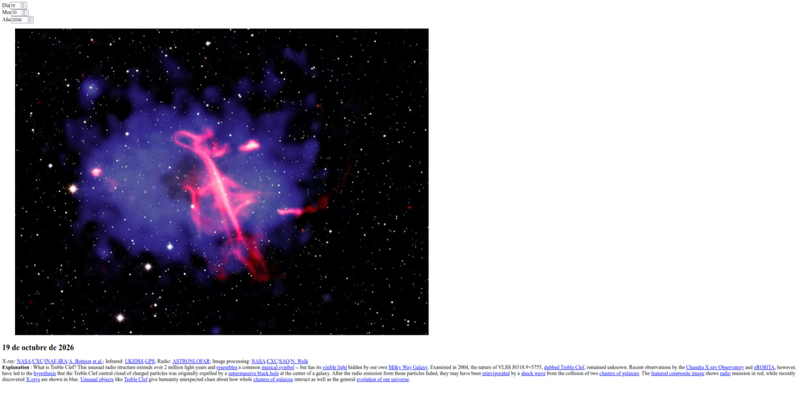

## Astronomy Picture of the Day (APOD)

Proyecto para la presentacion y almacenamiento de los datos proporcionados por APOD de Nasa, haciendo uso de contenedores Docker.

 
 Para ejecutarlo:   
`git clone https://github.com/Harico04/tarea_docker.git`   
`cd proyecto_tarea`   

Se requerira un .env con el siguiente formato:
POSTGRES_USER=admin
POSTGRES_PASSWORD=1234
POSTGRES_DB=imagenes_nasa

Finalmente:
`docker compose up --build -d`   

